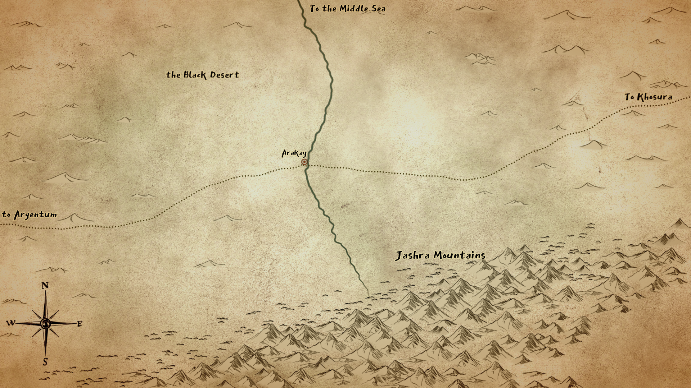
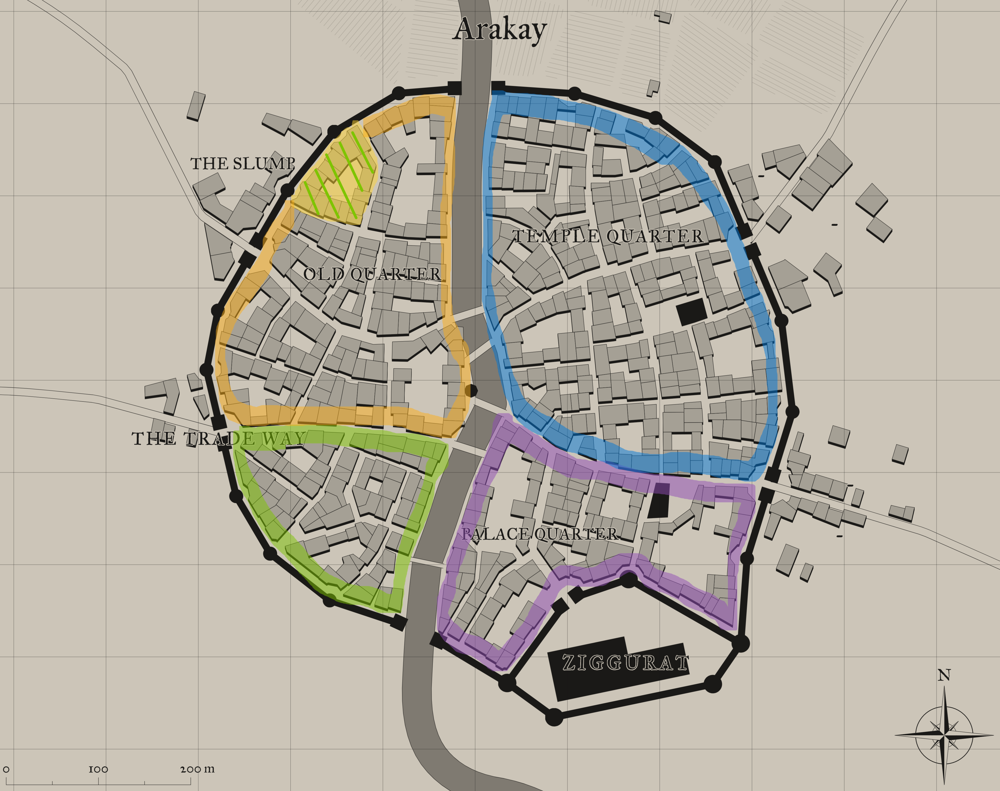
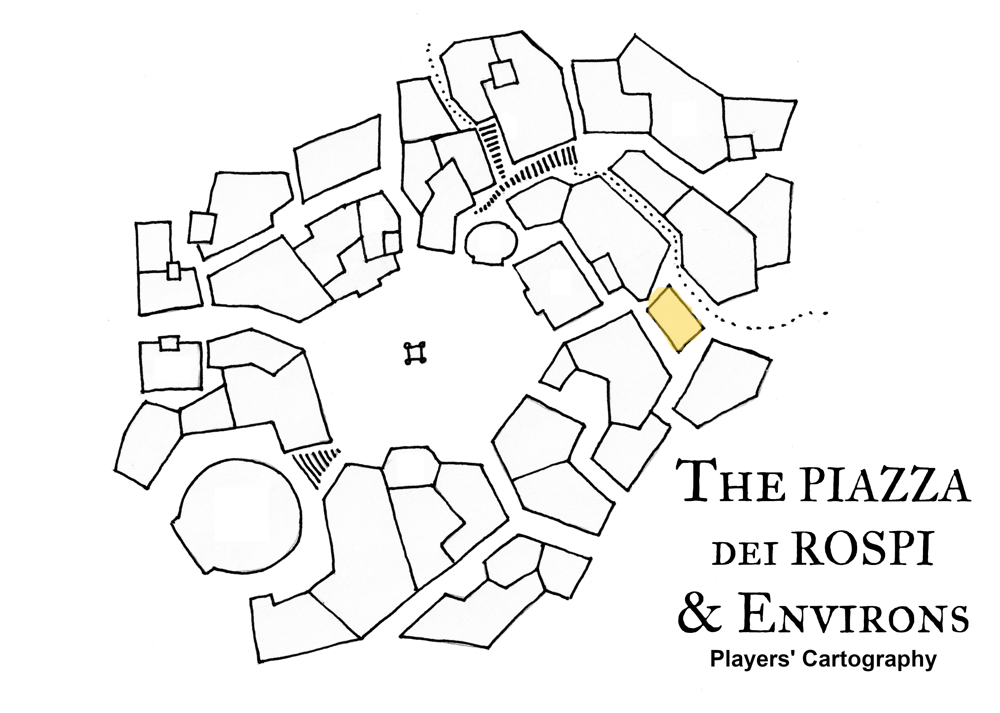
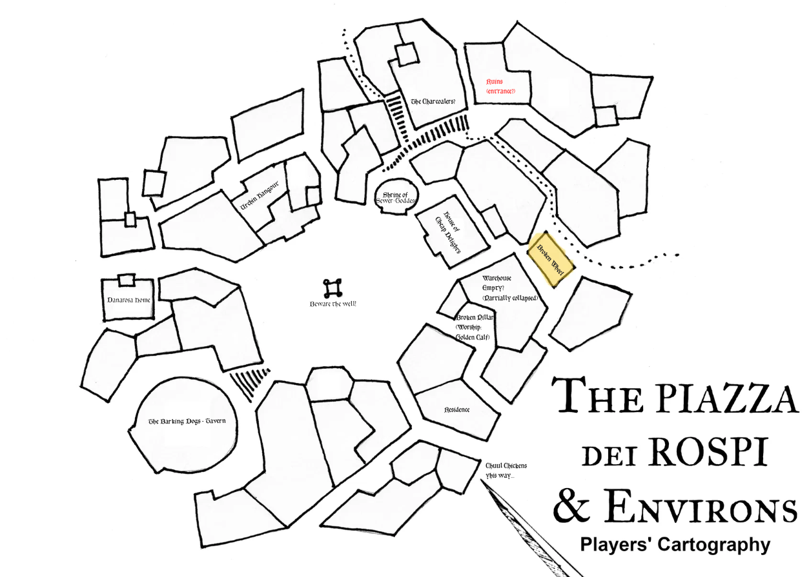
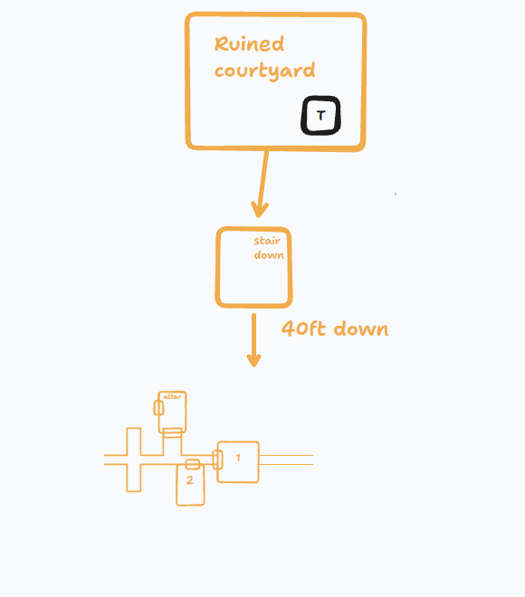
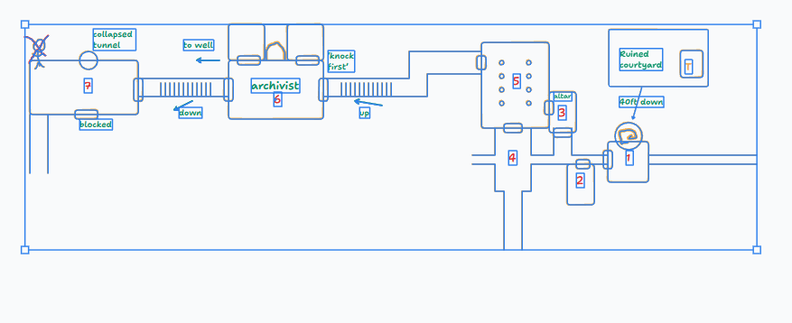

# Maps

Archived copies of the supplied campaign maps. Source notes are in [the source index](../../sources/index.md).

## Arakay and the Black Desert

- [Map notes](../../sources/source-arakay-region-map.md)
- [Regional location page](../../places/arakay-region.md)

## Arakay city map

- [Map notes](../../sources/source-arakay-city-map.md)
- [City location page](../../places/arakay.md)

## Piazza dei Rospi

- [Map notes](../../sources/source-piazza-dei-rospi-map.md)
- [Location page](../../places/piazza-dei-rospi.md)

## Piazza dei Rospi — labelled

- [Map notes](../../sources/source-piazza-dei-rospi-labelled.md)
- [Location page](../../places/piazza-dei-rospi.md)

## The Undercroft: schematic (superseded)

_Superseded by the 2026-11-01 annotated plan below. It is no longer shown on the maps page, and is kept because the Session 3 notes were taken against its numbering._

- [Map notes](../../sources/source-undercroft-schematic.md)
- [Location page](../../places/the-undercroft.md)

## The Undercroft: annotated (2026-11-01)

- [Map notes](../../sources/source-undercroft-map-2026-11-01.md)
- [Location page](../../places/the-undercroft.md)
- [Session 3 fact outline](../../sessions/session-003-facts.md)
