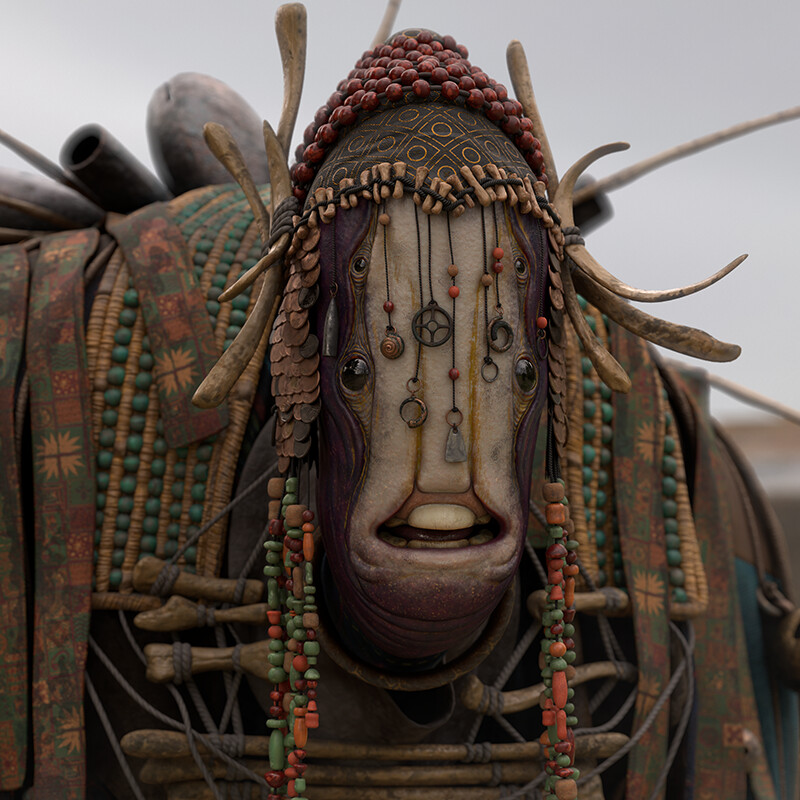

# Batros

**Aliases:** The Chül; B'AH'Trosss A'M Vess Uth Kassril'tassirr Pallosh  
**Role:** Chül trader in Arakay  
**Status:** Alive  
**First seen:** Session 1

## Summary

Batros is a Chül, a large, many-limbed creature who buys and sells gear in Arakay. Kollaro described him as a buyer for unwanted equipment. The party found him, and Ed bought a Fire Rock for five pieces, a stone that makes a loud noise when thrown down hard on the ground. The rest of the blanket was beyond their purses: a green rod of glowing metal, a silvery fabric pouch that looked costly, and a lapis-look necklace with a cat charm at 150 gp.

## What the party knows

- Lives or trades in Arakay.
- Buys and sells gear.
- Drives hard bargains.
- Ed bought a Fire Rock from a pile of them for 5 pieces.
- His wares included a green rod of glowing metal, said to sharpen a spell, a silvery fabric pouch nobody asked about, and a necklace that looked like lapis lazuli with a cat charm, at 150 gp.

## What is not established

- Species traits, AC, HP, attacks, or numbers.
- What a Chül is, and whether others of his kind trade in the city.
- Where he keeps his stock.
- Why he trades in the city.
- What the silvery pouch holds, or what he would ask for it.
