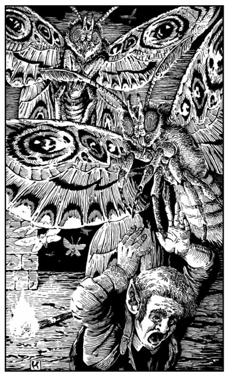

# Giant Lantern Moths

**Type:** Giant insect
**Status:** Three killed in Session 2
**First seen:** Session 2

## Summary

Grey, fuzzy, hand-sized-to-larger moths that roost on corridor ceilings under Arakay. They are drawn to light and will attack the source rather than the person holding it.

## What the party knows

- They are angered by light and go for torches and lanterns.
- They can be fought in the dark by anyone with infravision.
- Dio's torch is a liability as much as a help around them.

## Open questions

- [ ] `[?]` Are they natural, or bred in the tunnels?
- [ ] `[?]` What do they eat, and what else lives on them?
- [ ] `[?]` Does anything hunt them?
