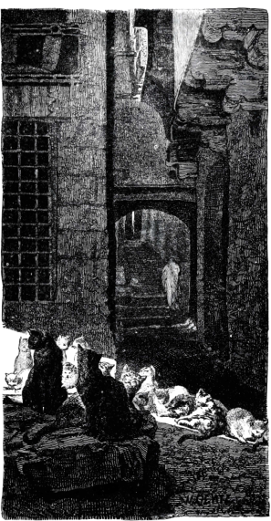
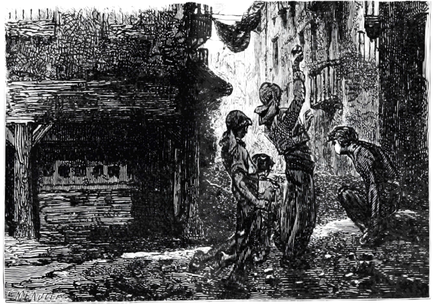

# The Piazza dei Rospi

**Type:** Urban piazza and surrounding neighborhood  
**Region:** Arakay; exact district unknown  
**Status:** Known from players' cartography  
**Map:** [Piazza dei Rospi — Players' Cartography](../assets/maps/piazza-dei-rospi-players-cartography.png)
**Labelled map:** [Piazza dei Rospi — Labelled, 2026-10-25](../assets/maps/piazza-dei-rospi-labelled-2026-10-25.png)

## Summary

A dense, irregular piazza enclosed by attached buildings, narrow alleys, stairs, and passages. The map is labeled **players' cartography**, so it records what the players have mapped rather than an authoritative survey.

## Map-derived features

| Feature | Description | Certainty |
|---|---|---|
| Central open space | Irregular piazza | `confirmed` on map |
| Central marker | Small four-lobed structure in the open space; now identified as [the Well of Frogs](well-of-frogs.md) | `confirmed` by Session 1 |
| Large circular structure | Southwest of the piazza | `confirmed` on map |
| Stairs and passages | North and southwest edges | `confirmed` on map |
| Dotted route | Enters from the northwest and exits east | `confirmed` on map |
| Yellow-highlighted building | East side of the piazza | `confirmed` on map; labelled **The Broken Wheel** on the 2026-10-25 version |

## Labelled features (2026-10-25 cartography)

| Label | Position | Status |
|---|---|---|
| [Danarosa Home](../people/npcs/lady-danarose.md) | West | `confirmed`; map spells it "Danarosa" |
| [Urchin Ruin](urchin-ruin.md) | North-west | `confirmed` |
| Ruins (entrance?) | North-east, on the dotted route | `confirmed`; deliberate label. This is the ruined building whose courtyard held the trapdoor into the dungeon, with the shanty district near it. Not the urchin ruin: two separate ruined sites |
| The Charcoalers? | North, beside broad steps | `reported`; the players' own query |
| Shrine of Sewer Goddess | North, west of the House of Cheap Delights | `reported` |
| House of Cheap Delights | North-east | `reported` |
| Broken Pillar (Worship: Golden Calf) | East | `confirmed` from Session 1 |
| Warehouse, Empty (Partially collapsed) | East | `reported` |
| [The Broken Wheel](broken-wheel.md) | East, yellow, on the dotted route | `confirmed` |
| The Barking Dogs - Tavern | South-west, circular structure | `confirmed` |
| Residence | South-east | `reported` |
| Chül Chickens this way | South, off the map | `reported` |
| Beware the well! | Centre, beside the well marker | `confirmed` by Session 1 |

## Inferred, not confirmed

- The central marker is the Well of Frogs; Session 1 confirms the well is in this piazza.
- The circular structure is **The Barking Dogs**, by the map's own 2026-10-25 label.
- The piazza may lie in the Old Quarter, Trade Way, or another district; the map does not place it.

## Unknowns

- Scale, street names, and building uses.
- Who controls the piazza or the surrounding buildings.
- What is in the partially collapsed warehouse.
- What lies below the north-east "Ruins (entrance?)" beyond the first dungeon level.
- The piazza's relationship to the Well of Frogs.

## Narrative use

The piazza is a strong scene space: crowded sides, narrow exits, a central marker, and one visually emphasized building. Do not assign a name or purpose to the central marker or highlighted building until the table establishes it.
