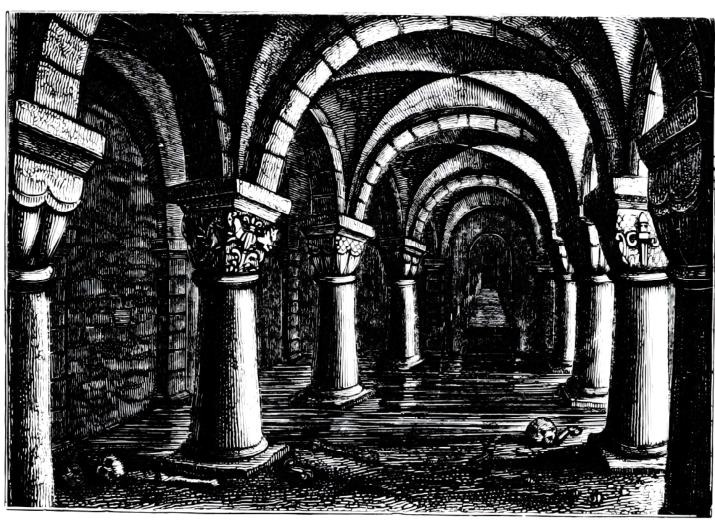

# The Undercroft

**Type:** Underground complex, first level
**Location:** Below the trapdoor in the ruined building on the shanty side of the charcoalers' stairs
**Status:** Explored in part
**First seen:** Session 2
**Schematic:** [Undercroft schematic, 2026-10-25](../assets/maps/undercroft-schematic-2026-10-25.png)

## Summary

The tunnels under Arakay, entered through a trapdoor in the courtyard of a ruined building. The stonework is better the deeper it goes. Lady Danarose says the deeper layers were built by **Acheron**, the demon empire that once terrorised the land.

The party explored a fraction of it in Session 2 and withdrew into the altar room to rest.

## Rooms and route

| Area | Description |
|---|---|
| Ruined building and courtyard | Weeds, rubble, an old collapse; five cats; trapdoor used recently |
| Store room | 10 × 10 ft, stone-carved, directly below the trapdoor |
| Circular stair | Descends about 40 ft to the 20 × 20 room |
| 20 × 20 room | Better stonework; west doorway; eastern corridor with no end in 30 ft; small skulls piled against the south wall |
| The dead room | 15 × 20 ft, 6 ft ceiling; ransacked; pool of dried blood; old campsite traces; smells of death. Not searched: the party felt uneasy |
| The domed hall | Cross-shaped, 15 ft wide, 30 ft deep, 20 ft dome; taxidermied animals, some humanoid; hallway south, doorway north, door west |
| The altar room | 15 × 15 ft at the end of a short corridor to the north; stone table-altar with a trapped compartment; west door; stone font |

## Known facts

- The schematic marks the ruined courtyard and its trapdoor, then the store room and stair, then "40ft down" to a corridor and junction.
- On the lower plan the **altar** room sits north, the **domed hall** is room **1** to the east, and the **dead room** is room **2** to the south.
- The south door of the moths' corridor opens into the dead room; the bloody footprints come from it.
- The north junction leads to the short corridor and the altar room.
- Tracks in the eastern corridor belong to many creatures going back and forth.
- The altar room was locked. Elowyn picked it.
- The cache: five rough-cut amber gems and two clay tablets, being divine scrolls.

## Open questions

- [ ] `[?]` What is through the west door of the 20 × 20 room?
- [ ] `[?]` What is through the west door of the domed hall and the south hallway?
- [ ] `[?]` What is in the unsearched dead room?
- [ ] `[?]` Who or what left the small skulls?
- [ ] `[?]` Is the domed hall the Collector's?

## Related pages

- [Piazza dei Rospi](piazza-dei-rospi.md)
- [Divine scrolls](../items/divine-scrolls.md)
- [Giant lantern moths](../bestiary/giant-lantern-moths.md)
- [Session 2](../sessions/session-002.md)
